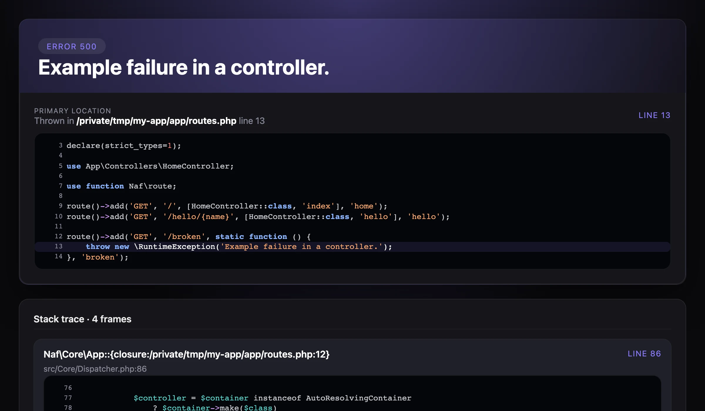
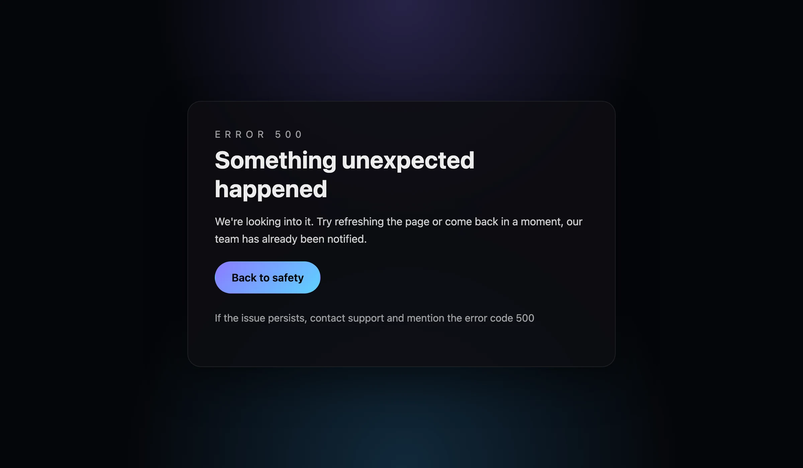

# Errors and aborting

An unknown route, a thrown exception or `abort()` reaches the error-handling path.
The default response uses the exception's callable `getStatusCode()` when it returns an
integer from 400 to 599, otherwise 500 (Framework 0.2.14+).

With Framework **0.2.12+**, an unsupported method on a known path throws
`Naf\Exceptions\MethodNotAllowedException` and produces 405 with `Allow`.
`getAllowedMethods()` returns the allowed method names. The normal error path retains
`Allow` when an exception listener returns a custom 405 response, including JSON.
An unknown path remains 404; see [Routing](routing.md).

## Abort a request

```php-inline
use function Naf\abort;

abort(404, 'The requested item was not found.');
```

`abort()` throws `Naf\Exceptions\AbortException`; it does not render a template or send a
response itself. Code after the call is not executed unless an outer layer catches the exception.
Avoid catching and discarding it inside a broad `catch (Throwable)`.

`abort()` passes the message through `htmlspecialchars()` before storing it, so
`$exception->getMessage()` returns `&quot;`, `&lt;` and similar entities for such characters.
Keep abort messages plain, or decode them with `htmlspecialchars_decode()` when a JSON
listener returns them to clients.

## Default output

The core supplies diagnostic and sanitized error templates. `APP_ENV=prod` and `APP_ENV=test`
use sanitized output; only the exact value `dev` shows diagnostics. Missing, empty, unknown
or invalid environment values also use sanitized output. Use the exact names documented in
[Configuration](configuration.md#application-environment).

With Framework **0.2.14+**, Composer autoloading registers the global error and exception
handlers for every environment and disables PHP error display. This covers failures before
and during application boot, including when `APP_ENV` is loaded from `.env` or `.env.local`
rather than supplied by the process. Before environment loading, output defaults to sanitized
unless the process already explicitly selects `dev`. Set production PHP's `display_errors`
and `display_startup_errors` to `Off` too: PHP startup failures and code that fails before
Composer loads cannot be protected by the framework.

Request-cycle failures use the application logger. Uncaught HTTP/bootstrap failures use PHP's
error log without trying to boot the application again; rendering failures have a minimal
500 fallback. Protect these logs because they contain internal diagnostics. CLI failures
continue to report their message and origin to STDERR and exit with status 1; a stack trace
is included only in `dev`.

??? note "Upgrading the test environment to Framework 0.2.14"

    `APP_ENV=test` no longer skips global handler registration. It selects sanitized HTTP
    output consistently, whether supplied by the process or an environment file. A test
    runner or host can install its own handlers after loading Composer; the framework
    does not re-register them during `app()` boot.

=== "APP_ENV=dev"

    { .screenshot loading=lazy }

=== "APP_ENV=prod"

    { .screenshot loading=lazy }

Both pages answer an exception thrown by a route handler with status 500. The diagnostic
page shows file paths and source code, which is why it must never reach production.

Placing `app/views/errors/404.phtml` in your application **does not automatically override**
the core error handler. To customize an error, return a response from the `exception` event.

## Customize an HTTP error

Register this in `bootstrap.php`, after the autoloader and before `app()->run()`:

```php-inline
use Naf\Core\{ErrorHandler, Event};
use function Naf\{event, response};

event()->listen(Event::EXCEPTION, function (\Throwable $exception) {
    if (ErrorHandler::resolveStatusCode($exception) !== 404) {
        return null; // Keep the default response for other failures.
    }

    return response('<h1>Page not found</h1>', 404, [
        'Content-Type' => 'text/html; charset=UTF-8',
    ]);
});
```

With `naf/view`, you can instead return `Naf\View\render('errors.404')->withStatus(404)`.
Pass any template data explicitly; no `$path` variable is injected automatically.

## JSON errors for an API

For expected validation failures, return `json($payload, 422)` from your handler. To cover
uncaught exceptions as well, register this before `app()->run()`:

```php-inline
use Naf\Core\{ErrorHandler, Event};
use function Naf\{event, json, log, request};

event()->listen(Event::EXCEPTION, function (\Throwable $exception) {
    if (!str_starts_with(request()->getUri()->getPath(), '/api/')) {
        return null;
    }

    log()->error('API request failed: {exception}', ['exception' => $exception]);
    $status = ErrorHandler::resolveStatusCode($exception);
    return json(['error' => $status >= 500 ? 'Internal server error' : 'Request refused'], $status);
});
```

Do not expose unexpected exception messages to clients. When a listener returns its own
response, it should also perform any logging you need. This hook handles failures during the
request cycle; a parse error in the bootstrap itself may occur before the listener exists.

Use [Logging and troubleshooting](troubleshooting.md) to diagnose failures without exposing details to clients.
